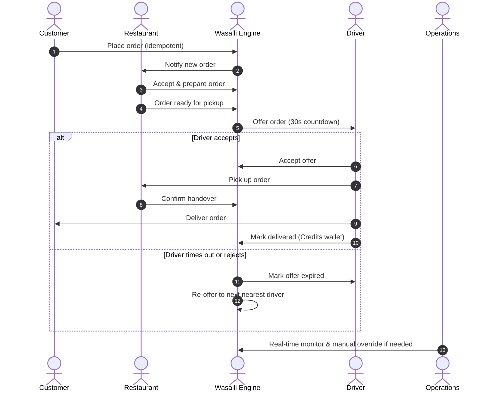

# Wasalli (وصلي) — Intelligent Delivery & Order Distribution Platform

[](https://laravel.com)
[](https://php.net)
[](https://react.dev)
[](https://tailwindcss.com)
[](https://vitejs.dev)
[](#testing)

**Wasalli** is a full-featured, real-time food and parcel delivery dispatch and operations platform built with **Laravel 12/13**, **React 19**, and **Tailwind CSS 4**. It features an automated driver matching engine with intelligent timeout-based re-dispatching, real-time GPS tracking via WebSockets, multi-role workspaces (Customer, Driver, Restaurant, and Operations Admin), digital wallet ledgers, and privacy/GDPR compliance.

---

## Table of Contents

- [Key Features](#key-features)
- [Architecture & Tech Stack](#architecture--tech-stack)
- [System Roles & Workflows](#system-roles--workflows)
- [Requirements](#requirements)
- [Quick Start & Installation](#quick-start--installation)
- [Configuration & Environment Variables](#configuration--environment-variables)
- [Database Seeding & Demo Accounts](#database-seeding--demo-accounts)
- [Running the Platform](#running-the-platform)
- [API Architecture](#api-architecture)
- [Background Tasks & Scheduling](#background-tasks--scheduling)
- [Testing & Quality Assurance](#testing--quality-assurance)
- [License](#license)

---

## Key Features

### 🛵 Intelligent Driver Dispatch & Auto-Expiry
- **Fair & Proximity Dispatch:** Orders are automatically evaluated and offered to active, nearby drivers prioritized by fewer completed deliveries to balance workload.
- **30-Second Timed Acceptance:** Drivers receive offers with an exact 30-second decision window.
- **Auto Re-offer:** If an offer is rejected or expires without action, the engine immediately dispatches the order to the next best candidate.
- **Background & Scheduled Expiry:** Enforced via real-time queue jobs and backed by a safety-net scheduler command (`delivery:expire-stale-offers`).

### 📦 Customer Experience
- **Restaurant & Menu Browsing:** Live directory of verified restaurants and categorised menu items.
- **Delivery Zone Pricing:** Dynamic delivery fees and estimated arrival times based on geographical delivery zones.
- **Idempotent Order Creation:** Strict idempotency key protection (`idempotency_key`) prevents duplicate orders on network retries.
- **Payment Options:** Support for Cash on Delivery (COD) and Manual Bank Transfer with proof-of-payment receipt upload.
- **Real-Time GPS Tracking:** Live driver position streaming via Pusher/Echo with customer-safe status projection (`placed` → `assigned` → `picked_up` → `delivered`).
- **Post-Delivery Reviews:** Double rating system allowing customers to rate both the restaurant and the delivery driver.

### 🚗 Driver Workspace
- **Availability Management:** Quick toggle between active/inactive status.
- **Live Location Updates:** GPS streaming (`PUT /api/v1/driver/location`) with location freshness safeguards.
- **Interactive Offer Response:** Accept or decline incoming delivery offers directly from the mobile-optimized interface.
- **Delivery Lifecycle Actions:** Seamless pickup confirmation and final drop-off verification.
- **Digital Wallet & Ledger:** Automatic `delivery_credit` ledger records per completed delivery, transparent transaction logs, and payout request workflows (`payout_debit`).

### 🍽️ Restaurant Management
- **Onboarding Gate:** Operations-assisted onboarding, unlocking self-service onboarding once platform adoption reaches threshold.
- **Menu Management:** Create, update, toggle availability, and set item prices.
- **Order Kitchen Workflow:** Real-time pipeline to accept orders, mark as preparing, and transition to ready for pickup.
- **Handover Verification:** Confirmation when an assigned driver arrives to pick up the order.
- **Bank Transfer Verification:** Review and approve customer bank transfer receipts.

### 🎛️ Operations & Admin Control Center
- **Live Order Monitoring:** Real-time overview of active deliveries, unassigned orders, and delays.
- **Manual & Automated Dispatch:** Trigger immediate automatic matching or dispatch to specific drivers.
- **Delivery Zone Configuration:** Manage zone boundaries, delivery fees, and estimated transit times.
- **Payment Gateway Settings:** Configure official bank transfer accounts, IBANs, and checkout instructions.
- **Audit Logging:** System-wide audit trails (`audit_logs`) capturing order state transitions and admin operations.

### 🔒 Privacy, Security & GDPR Compliance
- **Location Consent Gate:** Mandatory explicit user consent before storing or streaming GPS driver locations.
- **Right to Erasure (Account Deletion):** Scheduled 30-day purge pipeline (`PurgeAccountJob`) that anonymizes personal identification data while preserving necessary legal financial ledger records.

---

## Architecture & Tech Stack

| Component | Technology | Description |
| :--- | :--- | :--- |
| **Backend Framework** | Laravel 12/13 (PHP 8.4) | Domain Actions, Form Requests, Policies, Resources |
| **Frontend Framework** | React 19 + Tailwind CSS 4 | Single-page UI with Lucide React icons & Vite 8 |
| **Authentication** | Laravel Sanctum | API tokens, Guest mode, Google & Apple OAuth support |
| **Real-Time WebSockets** | Pusher / Laravel Echo | Event broadcasting (`DriverLocationUpdated`, order events) |
| **Database** | SQLite / MySQL / PostgreSQL | Transactional integrity with strict casting and foreign keys |
| **Queue & Scheduling** | Laravel Queue + Scheduler | Asynchronous dispatching, offer timeouts, retention purges |
| **Testing** | PHPUnit 12 | 144 feature and unit tests with complete coverage |

---

## System Roles & Workflows



---

## Requirements

- **PHP**: `^8.3` or `^8.4` (with `pdo`, `mbstring`, `bcmath`, `curl`)
- **Composer**: `^2.x`
- **Node.js**: `^20.x` or `^22.x` & **npm**: `^10.x`
- **Database**: SQLite (default for development/testing) or MySQL / PostgreSQL
- **Pusher Account** (optional for live production WebSockets; uses `log` driver locally by default)

---

## Quick Start & Installation

### 1. Clone the repository
```bash
git clone <repository-url> order-delivery
cd order-delivery
```

### 2. Automated Project Setup
You can run the full setup script configured in `composer.json`:
```bash
composer run setup
```
*This command runs `composer install`, copies `.env.example` to `.env`, generates the application key, runs migrations, installs npm packages, and builds frontend assets.*

Alternatively, run each step manually:
```bash
# Install PHP dependencies
composer install

# Environment file setup
cp .env.example .env     # On Windows: copy .env.example .env

# Generate app key
php artisan key:generate

# Run database migrations
php artisan migrate

# Install frontend dependencies and build
npm install
npm run build
```

---

## Configuration & Environment Variables

Key application configurations in `.env`:

```env
# Application
APP_NAME=Wasalli
APP_ENV=local
APP_KEY=base64:...
APP_URL=http://localhost:8000

# Database
DB_CONNECTION=sqlite

# Real-Time Broadcasting (set to "pusher" for live updates)
BROADCAST_CONNECTION=log
PUSHER_APP_ID=
PUSHER_APP_KEY=
PUSHER_APP_SECRET=
PUSHER_APP_CLUSTER=mt1
VITE_PUSHER_APP_KEY="${PUSHER_APP_KEY}"
VITE_PUSHER_APP_CLUSTER="${PUSHER_APP_CLUSTER}"

# Delivery & Dispatch Configurations
DELIVERY_OFFER_WINDOW_SECONDS=30
DELIVERY_LOCATION_FRESHNESS_SECONDS=60
DELIVERY_DISPATCH_CANDIDATE_LIMIT=50
DELIVERY_PERSONAL_DATA_PURGE_DAYS=30
DELIVERY_NOTIFICATION_DRIVER=log
DELIVERY_PAYMENT_DEFAULT_METHOD=cash_on_delivery

# Google Maps API (Optional, for frontend route rendering)
GOOGLE_MAPS_API_KEY=
```

---

## Database Seeding & Demo Accounts

Seed the database with rich mock data (restaurants, menu items, delivery zones, active drivers, and demo users):

```bash
php artisan db:seed
```

### Pre-configured Demo Accounts
All seed accounts use the default password: **`password`**

| Role | Email | Name / Description |
| :--- | :--- | :--- |
| **Admin / Operations** | `admin@wasalli.app` | Operations & Control Center Manager |
| **Customer** | `customer@wasalli.app` | Customer (Ahmed Khalil) |
| **Customer (Secondary)** | `customer2@wasalli.app` | Customer (Sara Abdullah) |
| **Driver (Primary)** | `driver@wasalli.app` | Driver (Mahmoud Al-Najjar) — 0 deliveries |
| **Driver (Secondary)** | `driver2@wasalli.app` | Driver (Yousef Al-Hassan) — 1 delivery |
| **Restaurant Manager** | `restaurant@wasalli.app` | Palmyra Restaurant Manager |
| **Restaurant Manager** | `restaurant2@wasalli.app` | Roma Pizza Manager |
| **Restaurant Manager** | `restaurant3@wasalli.app` | Al-Ameer Shawarma Manager |
| **Restaurant Manager** | `restaurant4@wasalli.app` | Al-Bahr Seafood Manager |

---

## Running the Platform

To run the entire development environment concurrently (Web Server, Queue Worker, Log Pail, and Vite HMR):

```bash
composer run dev
```

*Or run the services individually in separate terminal tabs:*

```bash
# 1. Start the Laravel HTTP server
php artisan serve

# 2. Start the Queue Worker (essential for 30s offer timeouts and purge jobs)
php artisan queue:work

# 3. Start the Task Scheduler (checks for stale offers every minute)
php artisan schedule:work

# 4. Start Vite development server for React HMR
npm run dev
```

Visit **`http://localhost:8000`** in your browser.

---

## API Architecture

The application exposes a clean, versioned RESTful API under `/api/v1/`:

### Authentication & Account (`/api/v1/auth`)
- `POST /api/v1/auth/register` — Register new customer account
- `POST /api/v1/auth/login` — Authenticate and obtain Sanctum bearer token
- `POST /api/v1/auth/guest` — Generate guest session token
- `POST /api/v1/auth/google` / `apple` — Social authentication
- `DELETE /api/v1/account` — Request GDPR account deletion (30-day purge schedule)
- `POST /api/v1/location-consents` — Grant or revoke GPS tracking consent

### Customer Endpoints (`/api/v1`)
- `GET /api/v1/delivery-zones` — List delivery zones and pricing
- `GET /api/v1/restaurants` — Browse active restaurants & menus
- `POST /api/v1/orders/quote` — Calculate delivery quote and pricing breakdown
- `POST /api/v1/orders` — Create order (with `idempotency_key`)
- `GET /api/v1/orders/{order}` — Track order status and live driver coordinates
- `POST /api/v1/orders/{order}/payment-proof` — Upload manual bank transfer receipt
- `POST /api/v1/orders/{order}/cancel` — Cancel pending order
- `POST /api/v1/orders/{order}/restaurant-rating` — Submit restaurant rating (1–5)
- `POST /api/v1/orders/{order}/driver-rating` — Submit driver rating (1–5)

### Driver Endpoints (`/api/v1/driver`)
- `GET /api/v1/driver/availability` — Check current driver status
- `PUT /api/v1/driver/availability` — Toggle online/offline status
- `PUT /api/v1/driver/location` — Stream real-time latitude & longitude
- `GET /api/v1/driver/offers` — View current delivery offer (with expiry countdown)
- `POST /api/v1/driver/offers/{assignment}/accept` — Accept delivery assignment
- `POST /api/v1/driver/offers/{assignment}/reject` — Reject offer (triggers immediate re-offer)
- `POST /api/v1/driver/assignments/{assignment}/pickup` — Confirm order pickup
- `POST /api/v1/driver/assignments/{assignment}/deliver` — Confirm drop-off (credits wallet)
- `GET /api/v1/driver/wallet` — View balance and ledger history
- `POST /api/v1/driver/payouts` — Request earnings payout

### Restaurant Endpoints (`/api/v1/restaurant`)
- `GET /api/v1/restaurant/orders` — View incoming kitchen orders
- `PATCH /api/v1/restaurant/orders/{order}/status` — Update order preparation status
- `POST /api/v1/restaurant/orders/{order}/handover` — Confirm driver handover
- `POST /api/v1/restaurant/orders/{order}/dispatch` — Trigger dispatch request
- `POST /api/v1/restaurant/orders/{order}/payment-review` — Review bank transfer receipt

### Operations & Admin Endpoints (`/api/v1/operations`)
- `GET /api/v1/operations/orders` — Monitor all platform orders in real time
- `POST /api/v1/operations/orders/{order}/dispatch` — Trigger auto-dispatch algorithm
- `POST /api/v1/operations/restaurants/{restaurant}/complete-onboarding` — Approve restaurant
- `GET|POST|PATCH|DELETE /api/v1/operations/delivery-zones` — Manage delivery zones & fees
- `GET|PUT /api/v1/operations/payment-settings` — Manage platform bank details

---

## Background Tasks & Scheduling

The platform relies on scheduled commands configured in `routes/console.php`:

```bash
# Expire stale driver offers that passed the 30-second window
php artisan delivery:expire-stale-offers

# Run scheduled tasks locally
php artisan schedule:work
```

- **`delivery:expire-stale-offers`**: Runs every minute as a safety net to clean up any offers that were missed by transient worker disconnects.
- **`PurgeAccountJob`**: Runs daily to anonymize user records whose 30-day retention countdown has elapsed.

---

## Testing & Quality Assurance

The codebase includes an extensive suite of automated tests verifying business logic, database transactions, race condition prevention, and API contracts.

```bash
# Run the full test suite
php artisan test --compact

# Or run via composer
composer test

# Run code style fixer (Laravel Pint)
vendor/bin/pint
```

**Test Coverage Highlights:**
- **144 tests / 678 assertions** covering 100% of core flows
- Fair driver dispatch and 30-second expiry simulation
- Idempotency guarantees for order placements and delivery credits
- Authorization policies across all user roles
- GDPR deletion retention and consent enforcement

---

## License

This software is open-sourced under the [MIT License](LICENSE).
